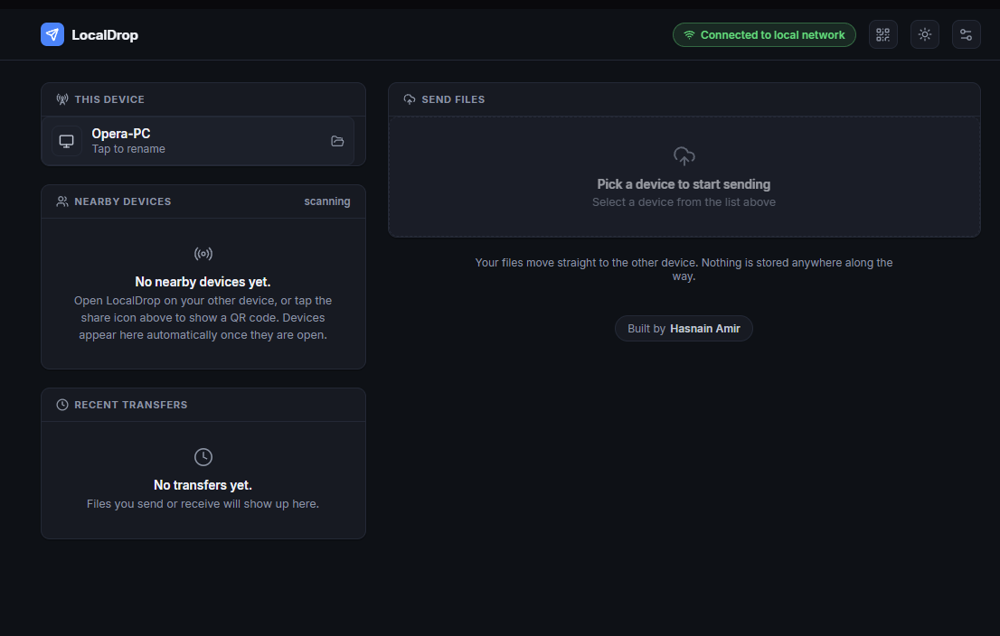
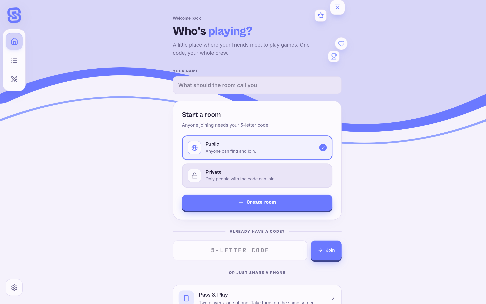
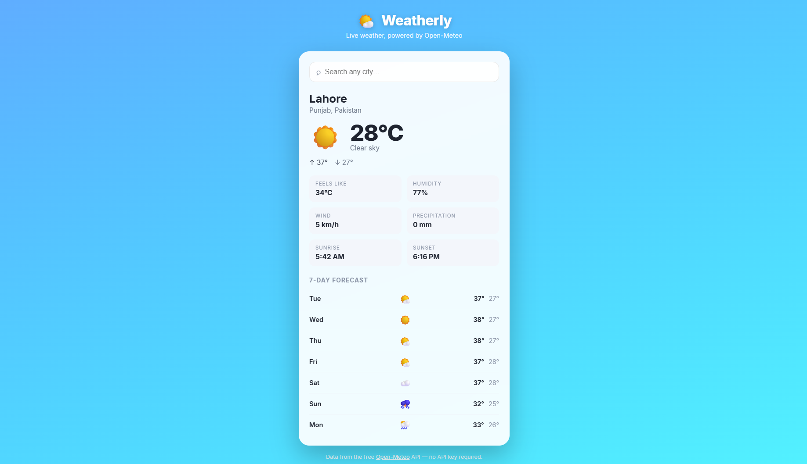

<picture>
  <source media="(prefers-color-scheme: dark)" srcset="assets/header-dark.svg">
  
</picture>

I started out scripting games on Roblox and running Minecraft servers, and I kept going. Now I build full stack web apps with React, Node and Supabase, and I'm doing my first internship as a full stack developer at [Visor Dynamics](https://visordynamics.uk).

## Things I've shipped

<table>
  <tr>
    <td width="33%" valign="top">
      
      <h3><a href="https://local-drop-hissu.vercel.app">LocalDrop</a></h3>
      AirDrop-style file sharing in the browser. Devices find each other, and files go straight from one to the other with live speed and ETA. No upload, no sign up.
        
      React · WebRTC · Node.js · Express · Socket.IO · Supabase Realtime
    </td>
    <td width="33%" valign="top">
      
      <h3><a href="https://kroop.vercel.app">kroop</a></h3>
      A real-time party room: a 5-character code, a live player list, room chat, and mini-games like Tic-Tac-Toe and Connect Four, with winner-stays rotation.
        
      React · Vite · Tailwind CSS · Supabase (Postgres + Realtime)
    </td>
    <td width="33%" valign="top">
      
      <h3><a href="https://weather-app-hissu.vercel.app">Weatherly</a></h3>
      Search any city for current conditions and a 7-day forecast, with debounced autocomplete and clean loading and error states.
        
      React · Open-Meteo API · fetch / async · CSS
    </td>
  </tr>
</table>

## What I build with

Currently learning: SQL and Postgres properly, through Supabase on real projects. MongoDB is next.

## Before the web

- **Roblox** (2023 to now): gameplay systems in Luau, with event triggers, timers and player interaction.
- **Minecraft** (2025 to now): private servers with custom worlds, redstone and command-block automation.
- **QGroundControl** (2026): modified UI layout components in the open-source Qt/QML ground control app.

## Activity

<picture>
  <source media="(prefers-color-scheme: dark)" srcset="dist/github-contribution-grid-snake-dark.svg">
  
</picture>

Building something almost every day. The full CV is at <a href="https://hasnain.is-a.dev">hasnain.is-a.dev</a>.
